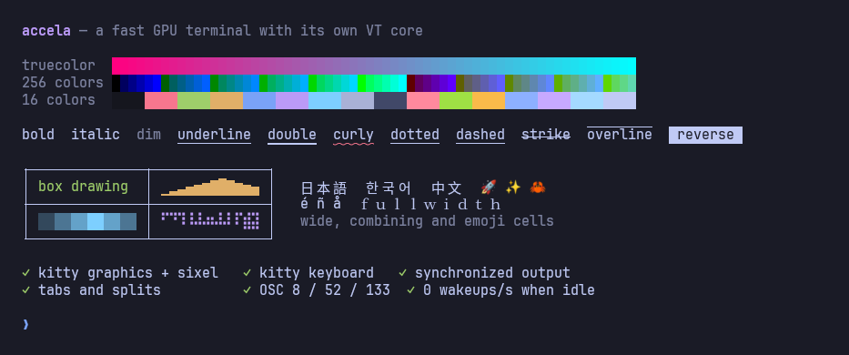

<div align="center">

# accela

**A fast, GPU-rendered terminal for Linux with its own VT core.**

Small when idle, quick under load, strict about what programs are allowed to do to you.

[](https://github.com/enrell/accela/actions/workflows/release.yml)
[](LICENSE)




</div>

## Why accela

- **Compatible.** It implements the whole `xterm-256color` terminfo entry, checked capability by
  capability against the entry installed on the machine, plus the modern protocols programs
  expect: kitty keyboard, kitty graphics, sixel, synchronized output, hyperlinks, shell
  integration.
- **Light.** 45 MB of memory and **0 wakeups per second** when idle. On hybrid laptops it
  renders on the integrated GPU and leaves the discrete one asleep.
- **Fast.** The emulator core parses 170–460 MB/s. The app reaches about 80% of what the
  Linux kernel PTY can deliver at all.
- **Careful.** Nothing a program prints can turn into a command or leak your data. Every
  buffer a program can grow has a limit.
- **Tested.** 248 tests in about two seconds, 93% line coverage in the core, a fuzzer in
  every run, and real programs (vim, neovim, htop, btop, fish…) driven end to end.

It has tabs, splits, scrollback search, a configurable keymap, IME input, inline images and
clickable links, and nothing else running in the background.

## Install

### From a release

Each release ships a tarball per architecture, a `SHA256SUMS` file and a signed build
provenance attestation.

```sh
tar -xzf accela-v*-x86_64-unknown-linux-gnu.tar.gz
install -Dm755 accela-v*/accela ~/.local/bin/accela
```

To check that an archive was built by this repository's release workflow:

```sh
sha256sum -c SHA256SUMS --ignore-missing
gh attestation verify accela-v*-x86_64-unknown-linux-gnu.tar.gz --repo enrell/accela
```

### From source

You need Rust (the version is pinned in `rust-toolchain.toml`; `rustup` picks it up) and the
development packages for xkbcommon, Wayland, fontconfig and Vulkan. On Debian or Ubuntu:

```sh
sudo apt install pkg-config libxkbcommon-dev libxkbcommon-x11-dev libwayland-dev \
    libx11-xcb-dev libxcb1-dev libfontconfig1-dev libfreetype-dev libvulkan-dev

git clone https://github.com/enrell/accela && cd accela
scripts/install.sh      # release build into ~/.local/bin, plus a menu entry
```

## Usage

```sh
accela                          # your shell ($ACCELA_SHELL > `shell` in the config > $SHELL)
accela -d ~/projects -e htop    # starting directory and command
```

| Shortcut | Action |
|---|---|
| Ctrl+Shift+T | new tab, in the current directory |
| Ctrl+Tab / Ctrl+Shift+Tab, Ctrl+Shift+PageDown/PageUp | next / previous tab (click a tab to switch, middle-click to close) |
| Ctrl+Shift+Alt+PageUp/PageDown | move the tab left / right (or drag it) |
| Ctrl+Shift+D / Ctrl+Shift+E | split side by side / top and bottom |
| Ctrl+Shift+H/J/K/L | focus the pane to the left / below / above / right |
| Ctrl+Shift+Alt+H/J/K/L | resize the pane (or drag the divider) |
| Ctrl+Shift+W | close the pane (exiting the shell closes it too) |
| Ctrl+Shift+N | new window in the current directory (OSC 7) |
| Ctrl+Shift+F | search the scrollback: Enter = previous, Shift+Enter = next, Esc closes |
| Ctrl+Shift+C / Ctrl+Shift+V | copy / paste |
| Shift+Insert, middle button | paste the primary selection |
| Shift+PageUp/PageDown/Home/End | scroll the history |
| Ctrl+Shift+↑ / ↓ | jump to the previous / next prompt (OSC 133) |
| Ctrl+= / Ctrl+- / Ctrl+0 | zoom |
| Ctrl+click | open a link (OSC 8, or a URL in the text) |
| double / triple click, Alt+drag | select a word / a line / a block |
| Shift + mouse | select even when the program has captured the mouse |

A scrollbar appears on the right when there is history; click or drag it.

Search is smart-case ("error" finds "Error"; "Error" does not find "error"), matches text
that crosses soft line wraps, and highlights every occurrence. If text is selected when
search opens, it becomes the query.

## Configuration

`~/.config/accela/config` (or `$ACCELA_CONFIG`). An invalid value prints a warning and falls
back to the default, so the terminal always opens.

```ini
font_family = JetBrainsMono Nerd Font Mono
font_size = 15
line_height = 1.25
padding = 6
scrollback = 10000
cursor_blink = true
bold_is_bright = false
gpu = auto              # auto (integrated on hybrid laptops) | discrete | any
background = #1a1b26
foreground = #c0caf5
color1 = #f7768e        # color0 … color255

# bind = <keys> <action>  |  <keys> none (hands the key back to the program)  |  clear
bind = alt+t new_tab
bind = ctrl+shift+w none
```

Actions: `new_tab`, `new_window`, `close_pane`, `split_right`, `split_down`,
`focus_left/down/up/right`, `resize_left/down/up/right`, `next_tab`, `prev_tab`,
`move_tab_left`, `move_tab_right`, `copy`, `paste`, `paste_primary`, `search`, `zoom_in`,
`zoom_out`, `zoom_reset`, `scroll_page_up`, `scroll_page_down`, `scroll_top`,
`scroll_bottom`, `prev_prompt`, `next_prompt`. Modifiers: `ctrl`, `shift`, `alt`, `super`.

`ACCELA_DEBUG_KEYS=1 accela` prints every key that arrives to stderr, which helps when the
compositor is swallowing a shortcut.

## Compatibility

accela announces `TERM=xterm-256color`, `COLORTERM=truecolor` and `TERM_PROGRAM=accela`, and
honours that entry in full. A test reads the installed terminfo and checks **all** 104 output
capabilities (exact effect), all 159 key capabilities (byte for byte, including the whole
keypad in application mode) and the 26 line-drawing characters (`acsc`), with no exceptions.

| Area | Support |
|---|---|
| Base | VT100/VT220/xterm: cursor movement, editing (ICH/DCH/IL/DL/ECH/REP), scroll region, **left/right margins (DECLRMM/DECSLRM)**, origin mode, tabs, DEC charsets (G0–G3, SO/SI, SS2/SS3), DECALN, RIS/DECSTR |
| Text | UTF-8, wide characters (CJK, emoji), combining marks and ZWJ, reflow on resize, box drawing and block elements drawn as geometry so lines always connect |
| Style | full SGR: 16/256/truecolor (`;` and `:` forms), bold, dim, italic, single/double/curly/dotted/dashed underline with colour (SGR 58), strikethrough, overline, inverse, hidden, reverse video |
| Screens | 47 / 1047 / 1048 / 1049, bounded scrollback |
| Keyboard | legacy xterm (modifiers, application cursor/keypad, full keypad in application mode), **kitty keyboard protocol** (every flag, per-screen stack), IME/compose |
| Mouse | 9 / 1000 / 1002 / 1003 with X10, UTF-8 (1005), SGR (1006), urxvt (1015) and SGR-pixels (1016) encodings; alternate scroll (1007) |
| Modern modes | bracketed paste (2004), **synchronized output** (2026, with a timeout), focus events (1004), light/dark theme reports (996 / 2031) |
| Queries | DA1/DA2/DA3, XTVERSION, DSR/CPR, DECRQM, DECRQSS, XTGETTCAP, XTWINOPS 14/16/18, XTSMGRAPHICS, colours via OSC 4/10/11/12 (answers with the terminator the question used) |
| OSC | title (0/2) and title stack (22/23), cwd (7), hyperlinks (8), notifications (9 / 777), clipboard (52, write only), shell integration (133), resets 104/110/111/112 |
| Images | **kitty graphics** (RGB/RGBA/PNG, chunked transfer, `a=t/T/p/q/d`, z-index, `C=1`, anchored to the text through scrolling and reflow) and **sixel** (raster attributes, RGB and HLS colours) |
| Cursor | block/bar/underline, blinking (DECSCUSR), hollow outline when unfocused |

Tested end to end with bash/readline, fish, vim, neovim, less, htop, btop, nano, Python
curses, git with a pager, and tput.

<details>
<summary><b>Programs that pick features by terminal name</b></summary>

Some programs don't ask the terminal what it supports. They look `TERM_PROGRAM` up in a list
of names they know and switch everything else off for names they don't, such as `accela`.
grok, for example, sends images and uses the kitty keyboard only for kitty, Ghostty, WezTerm
and iTerm2. Measured with the real program: as `accela` it sends 0 image commands; presented
as `kitty` it sends the image and accela draws it.

The fix that doesn't lie to every other program is to present accela as kitty to that one
program, and only inside accela (fish):

```fish
# ~/.config/fish/functions/grok.fish
function grok --wraps grok
    if test "$TERM_PROGRAM" = accela
        TERM_PROGRAM=kitty command grok $argv
    else
        command grok $argv
    end
end
```

</details>

## Security

Nothing a program writes to the screen can become a command or leak data.

- **No echo of program-controlled data.** CSI 21 t (report the title) and reading the
  clipboard through OSC 52 are refused: both are classic injection and exfiltration vectors.
- **Pasting is safe.** Control characters are stripped, so pasted text can't close bracketed
  paste (`ESC[201~`) or run escape sequences.
- **Images are in-band only.** Transfer by file, temporary file or shared memory (`t=f/t/s`)
  is refused, so a program (a remote one included) can't make the terminal read local files.
- **Links.** Only `http(s)`, `file`, `mailto` and `ftp` are opened, and only on Ctrl+click.
- **Memory limits** on everything a program controls: screen size, title, stacks, hyperlinks,
  DCS/APC strings, images (64 MiB each, 256 MiB in total, oldest evicted first), sixel (about
  4K) and repeat counts. `cat /dev/urandom` does not take the terminal down.
- **Titles and notifications** have control characters removed and a bounded length.
  `notify-send` is called without a shell.
- **PTY.** Every fd is `O_CLOEXEC` and the child closes everything above 2 before `exec`; the
  signal mask and dispositions are reset; only async-signal-safe calls run after `fork` (the
  environment and `PATH` are resolved beforehand). On close: SIGHUP, then SIGKILL after a
  grace period, and the child is reaped (no zombies).

Found a problem? Please open a private security advisory on GitHub rather than a public issue.

## Performance

Measured on the real app (release build, 933×1000 window, hybrid Intel + NVIDIA laptop).

| Situation | Memory (RSS / anonymous) | CPU |
|---|---|---|
| Idle | **45 MB / 21 MB** | 0%, 0 wakeups/s (cursor not blinking) |
| Full scrollback (10k lines) | 55 MB / 30 MB | — |
| After 21 MB of output | 63 MB / 38 MB, stable across runs | back to ~0 |

All three rendering paths were checked on the same machine and draw identically:

| Renderer | RSS (anonymous) | Idle CPU | Driver loaded |
|---|---|---|---|
| Integrated (Intel; the default on hybrids) | **48 MB (21)** | 0 | `libvulkan_intel` |
| Discrete (`gpu = discrete`) | 323 MB (104) | 0.6% | NVIDIA |
| No GPU (lavapipe, on the CPU) | 133 MB (42) | 0 | `libvulkan_lvp` |

Core throughput (`cargo run --release -p accela-vt --example bench`; 200×50, 10k scrollback):

| Workload | Throughput |
|---|---|
| ASCII | ~460 MB/s |
| short lines (`seq`) | ~170 MB/s |
| coloured logs (256 colours + truecolor) | ~220 MB/s |
| mixed Unicode (CJK, emoji, combining) | ~110 MB/s |
| full-screen redraw (vim/htop style) | ~950 MB/s |

The real ceiling is the kernel: the Linux tty layer hands over about 38 bytes per read on
average, and output tops out near 30 MB/s with no terminal at all
(`cargo run --release -p accela-e2e --example pty_throughput`). The app reaches **~24 MB/s,
about 80% of that ceiling**, with `seq` or `cat`.

<details>
<summary><b>What keeps it light</b></summary>

- **GPU.** Only the Vulkan drivers for GPUs that are present get loaded. On hybrid laptops the
  terminal uses the integrated GPU and doesn't wake the discrete one: that alone took idle
  memory from 150 MB to 45 MB. `gpu = discrete` (or `any`) changes it, and a
  `VK_LOADER_DRIVERS_SELECT` you set yourself always wins. The variable accela sets for itself
  is **not** passed to the shell, so programs started in it see the original environment.
- **Rows.** Each row remembers how far it has been written. Clearing or trimming a row touches
  only that span (7 cells for `seq`, not 200). On scroll the screen row is reused and the
  history gets a copy of the exact size.
- **PTY reads.** A dedicated thread drains everything already available into one batch (up to
  256 KB) instead of waking the interface hundreds of thousands of times. The channel is
  bounded, so a slow interface applies backpressure to the program instead of piling up
  memory. Writes have their own thread too, so a large paste doesn't freeze the window.
- **Drawing.** The screen is redrawn only when there is new output. Synchronized output holds
  the frame until the update ends. The blink timer runs only while focused. Text is batched
  by style and trailing spaces aren't drawn.
- **An idle window stays asleep.** Upstream GPUI asks the compositor for a frame callback on
  every frame, waking the main thread about 60 times a second forever. A small patch
  ([`third_party/gpui/ACCELA_PATCH.md`](third_party/gpui/ACCELA_PATCH.md), with the diff)
  requests frames only when something needs drawing: at rest, **0 wakeups/s**
  (`scripts/idle-wakeups.sh`).

</details>

## Architecture

```
crates/
  accela-vt    emulator: VT parser, screen, protocols, keyboard, mouse, selection, images   (unicode-width only)
  accela-pty   hardened PTY on top of libc                                                 (libc only)
  accela       GPUI app: tabs, splits, search, rendering, events, IME, clipboard, config
  accela-e2e   harness: real programs (vim, nvim, htop, less…) running on accela-pty + accela-vt
third_party/
  gpui         vendored GPUI 0.2.2 with the idle-frame patch
  xattr        vendored with a one-line libc fix
```

The core has no GUI and does no I/O: bytes in, grid out. That is what makes it possible to
test and fuzz it in milliseconds.

## Tests

```sh
scripts/check.sh                            # the gate: fmt + clippy (-D warnings) + every test
ACCELA_FUZZ_CASES=20000 scripts/check.sh    # plus deep fuzzing (~6M operations)
scripts/coverage.sh [--html]                # coverage of the core crates
```

No test sleeps. Each one waits for a condition (text on screen, EOF, a mode being set) with a
timeout, so the suite is deterministic.

| Layer | Where | What it guarantees |
|---|---|---|
| Unit | `src/*` (`#[cfg(test)]`) | parser, cells, colours, base64, keyboard, mouse, selection, URLs, search, images, config, frame building, box drawing, scrollbar, split tree, bindings, CLI |
| Conformance | `accela-vt/tests/screen.rs` | VT/xterm behaviour of each sequence (cursor, editing, scrolling, wrapping, margins, charsets, screens) |
| Terminfo contract | `accela-vt/tests/terminfo.rs` | every `xterm-256color` capability; a new unclassified capability fails the test |
| Protocols and security | `accela-vt/tests/protocols.rs` | exact replies to queries, and refusal of what is dangerous |
| Reflow | `accela-vt/tests/reflow.rs` | resizing loses no text, cursor position, wide or combining characters, or marks |
| Images | `accela-vt/tests/graphics.rs` | placement, scrolling, reflow, clearing and limits |
| Fuzz | `accela-vt/tests/fuzz.rs` | random streams (fixed seed, reproducible) plus every byte after every parser state, checking structural invariants at each step |
| PTY | `accela-pty/tests/pty.rs` | real processes: output, status, signals, size, environment, fd leaks, signal mask, Ctrl+C, cleanup |
| Interface (headless) | `accela/src/workspace.rs` (`gui_tests`) | the real `Workspace` with real terminals and shells, driven by keys through GPUI's normal dispatch with no window or GPU |
| End to end | `accela-e2e/tests/apps.rs` | real programs render and respond; skipped when a program isn't installed |

Today: **248 tests in about 2 s** once compiled, and **93% line coverage** in the core (parser
97%). The fuzzer has already caught 5 real bugs (orphaned wide characters in edge cases)
before they reached anyone.

## Releases

Pushing a `vX.Y.Z` tag that matches the version in `Cargo.toml` runs
[`release.yml`](.github/workflows/release.yml): it runs the full test gate, builds x86_64 and
aarch64 binaries with locked dependencies, and publishes them with checksums and a signed
provenance attestation. The workflow uses only GitHub's own actions pinned by commit hash,
needs no secrets, and grants write access only to the final publishing job.

## The name

*Accela* is the nanomachine in *Serial Experiments Lain* that speeds up perception.

## License

[MIT](LICENSE). The vendored crates under `third_party/` keep their own licenses (Apache-2.0
for GPUI; MIT or Apache-2.0 for xattr).
